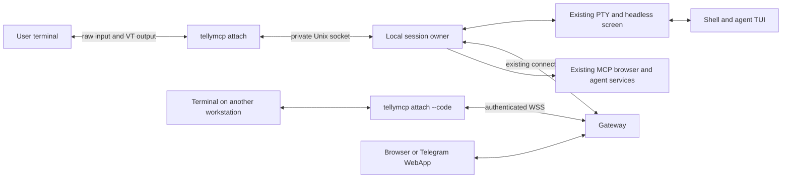

# Detached sessions in TellyMCP

Status: stage-1 accepted; Linux local owner and public CLI implemented under review,
updated 2026-11-07.
Branch: `feature/detached-sessions`, merged with `main` at `13a14e0` in
`b34bb74`. Current package baseline: `0.0.43`; the original `0.0.38` baseline
is historical. Local commands and Telegram-code remote attach are implemented
in source; real deployment/release acceptance remains pending.

TellyMCP should keep a running local console alive when its terminal disconnects,
an SSH connection drops, or the user deliberately sends the session into the
background. Reattaching must return to the same shell and agent processes with
their current screen. The existing terminal experience and single
`@deadragdoll/tellymcp` package remain the product contract.

The same attachment client should also reach an existing console through the
gateway from another workstation authenticated as the same account. Local and
remote attach share terminal semantics and the background owner; they differ
in transport and authorization.

## Scope

The first release targets Linux and provides one background owner process per
console session, one interactive controller, explicit detach, discovery,
reattach, and explicit stop. Implementation proceeds from local attach to
gateway attach using the same owner protocol. Attached input and output continue through
the PTY without a replacement Telly interface.

Windows, panes, windows, terminal layouts, shared interactive viewers, automatic
agent restart, and restoration after host reboot are outside this release.
macOS support requires its own process and terminal integration checks.

Survival depends on the owner process remaining alive. A host shutdown, owner
crash, or administrator terminating the user's processes ends the live session.
A system configured to kill every process in a login session on logout may need
a user service or administrator configuration; daemonizing alone does not
override that policy. Test the deployed SSH/login configuration before claiming
disconnect survival on that host.

## Current implementation

[`foregroundTerminalRuntime.ts`](../src/services/features/telegram-mcp/src/features/foreground-terminal/model/foregroundTerminalRuntime.ts)
creates the embedded broker, registers the console, optionally starts an agent,
and connects the current terminal directly to its PTY. Finishing that attachment
currently stops the broker and all PTYs in the process.

[`ptyRegistry.ts`](../src/services/features/telegram-mcp/src/shared/integrations/terminal/ptyRegistry.ts)
owns `node-pty` processes and headless xterm buffers in a process-local map. It
already supports input, resize, output subscriptions, and terminal capture.
`subscribePtyTarget` can unsubscribe without killing a PTY, but the foreground
launcher currently couples attachment completion to runtime shutdown.

The current initial foreground capture is plain text. It cannot be reused as
the reconnect screen because it does not reconstruct terminal modes and styles.
The runtime shutdown in
[`runtime.ts`](../src/services/features/telegram-mcp/src/app/bootstrap/runtime.ts)
also stops PTYs; that shutdown must belong exclusively to the background owner.

## Process ownership



The owner runs the existing embedded broker, console registry, PTY, browser
bridge, MCP endpoint, and managed agent backends. An attachment runs none of
those services. It therefore cannot create a second gateway identity, bind the
browser port again, or launch a second agent merely by reconnecting.

The owner is launched through the installed package entrypoint with
`process.execPath`, an internal command, an absolute env-file path, the original
workspace, and validated startup options. Its working directory and shell
environment must match the current foreground launch. Do not pass secrets in
command-line arguments or copy the entire environment into discovery metadata.

Use a detached child process, independent standard descriptors, and `unref()`.
Owner logs go to the existing file logger rather than to an attached terminal.
The public launcher waits for a successful local `ready` handshake with a
deadline. A PID or a created socket file alone does not mean startup succeeded.
If startup fails, clean up only that owner's partial resources and report the
failure; do not silently start another shell. See the
[Node child-process documentation](https://nodejs.org/download/release/v26.9.0/docs/api/child_process.html#optionsdetached)
for the underlying detached process and descriptor requirements; verify them
against the project's supported Node 24 runtime during implementation.

## Local command behavior (development branch)

| Command or action                     | Behavior                                                                                                                                                                                 |
| ------------------------------------- | ---------------------------------------------------------------------------------------------------------------------------------------------------------------------------------------- |
| `tellymcp run`                        | Start the workspace session owner and attach. If that exact session is already running, attach to it.                                                                                    |
| `tellymcp run --detach`               | Start the owner, wait for readiness, print session identity, and return. An interactive TTY is not required.                                                                             |
| `tellymcp run --agent codex --detach` | Start the managed agent once within the new owner. Reuse existing provider launch semantics.                                                                                             |
| `tellymcp sessions`                   | List this OS user's local owners, with an opaque local handle, console identity, label, cwd, lifecycle state, and attachment state.                                                      |
| `tellymcp attach [handle]`            | Attach to the exact existing owner; never create or resume a different process. Without a handle, show an interactive picker, initially selecting the available current workspace owner. |
| `tellymcp stop [handle]`              | Explicitly stop the owner, its agent backends, shell, PTY, and embedded services. Without a handle, show a repeating picker until empty or cancelled.                                    |
| `Ctrl+]` followed by `d`              | Detach locally and restore the outer terminal. The owner continues. `Ctrl+]` twice forwards a literal prefix.                                                                            |
| `Ctrl+C` / `Ctrl+D` typed normally    | Forward to the PTY so the foreground program and shell retain their normal behavior.                                                                                                     |

The detach prefix parser must handle split reads and forward unmatched bytes in
order. Paste data is forwarded intact; a pasted prefix must not accidentally
detach the client. Check this against bracketed paste and common agent bindings.

Existing `--env`, session flags, `.mcpsession.json`, shell configuration, and
provider selection keep their meaning. Reattaching with `--agent` does not
launch an agent again. Incompatible requested provider or startup configuration
must produce a clear conflict instead of modifying a running owner.

Repeated `run` calls must be idempotent, including concurrent invocations. An
existing foreground process cannot transfer its live PTY into a new owner;
sessions launched before this feature need a fresh launch to gain detach support.

## Lifecycle and failure behavior

Lifecycle and attachment are separate state values. An owner moves through
`starting`, `running`, `stopping`, and `exited`; a running owner may be attached
or detached.

| Event                                                                  | Owner behavior                                                                                                              |
| ---------------------------------------------------------------------- | --------------------------------------------------------------------------------------------------------------------------- |
| Detach command, attachment socket EOF, frontend death, terminal hangup | Release the attachment; retain shell, PTY, services, and gateway identity.                                                  |
| Gateway restart or network interruption                                | Use the existing gateway reconnect path; keep the local session. Reconnect alone does not inject an agent instruction.      |
| Agent TUI exits to its shell                                           | Keep the shell and owner running. Do not relaunch the agent.                                                                |
| Shell / PTY exits                                                      | Notify the attachment of the actual exit status, shut down owned services, and remove live discovery state.                 |
| Explicit `stop`, or owner receives a termination request               | Stop once, close listeners, terminate owned child processes, and remove only this owner's runtime files.                    |
| Owner dies unexpectedly                                                | Mark the old owner unavailable on discovery; attach reports that the live process was lost. No automatic replacement shell. |

The frontend handles `SIGHUP`, external `SIGTERM`, stdin EOF, stdout failure, and
socket failure as attachment termination. It restores raw mode and terminal
settings on every recoverable exit path, without calling broker shutdown.
An uncatchable frontend kill must still leave the owner alive; terminal recovery
after such a kill may require the user to reset the outer terminal.

**Updated user decision on 2026-11-08 (T047):** several local/remote native
terminals can read and write the same shell alongside mirrored writable Live.
Each native attachment has an independent snapshot/ACK, UTF-8 input decoder,
sequence queue and backpressure. Losing one does not evict the others. No takeover
or forced eviction is needed for a terminal forgotten on another workstation.
The latest attach or resize, including Live, sets the one shared PTY size.
Disconnect does not resize. Native clients with different physical dimensions
project the authoritative screen; smaller windows clip it instead of rewrapping.
The earlier single-native-controller rule describes released0.0.44 only.

## Local discovery and identity

Use a private directory owned by the OS user, with mode `0700`, under a suitable
user runtime directory. Validate ownership and permissions before reuse. Use
short hashed socket paths to stay within Unix socket path limits; socket files
are restricted to the owner. No new TCP listening port or gateway credential is
needed for local attach.

Discovery records contain a format version, local handle, random owner instance
ID, PID, process-start identity, socket path, package/protocol versions, console
IDs, cwd, env-file path, start time, and state. They contain no tokens or env-file
contents. Publish records atomically only after the owner is ready.

Use the canonical workspace and local session ID for the local startup lock;
resolve `.mcpsession.json` once and pass the resolved identity into the owner.
Retain its stable `gateway_client_uuid` and `local_session_id` on every attach.
Workspace paths are discovery context, never a substitute for canonical IDs in
gateway routing. Reject a second local owner claiming an already running
canonical gateway console identity, even through a different workspace path.

Startup requires an exclusive lock before creating the broker or PTY. Socket
handshakes verify the expected owner instance and identity. A PID existence
check is insufficient because PIDs can be reused. Stale-lock recovery must prove
the recorded owner is gone, probe its socket, and recheck state under the startup
lock before removing anything. Ambiguous ownership returns an error.

## Local transport

Use a versioned framed Unix-stream protocol, not newline-delimited terminal
output. Terminal bytes may contain arbitrary line breaks and escape sequences.
Frame decoding must tolerate split headers and multiple frames in a single read.

Proposed messages are `hello`, `ready`, `attach`, `snapshot_begin`, snapshot data,
`snapshot_end`, output data, input data, `resize`, `detach`, `stop`, `exit`, and
`error`. Control messages use validated JSON; input and output use data frames.
Each output frame carries a monotonic sequence number within one owner instance.
Input encoding must handle multibyte characters split between socket reads;
preserve the current UTF-8 PTY behavior without converting input into lines.

Reject unsupported protocol versions, invalid dimensions, oversized frames,
wrong instance IDs, and input from a noncontrolling attachment. Package updates
must not silently restart an existing owner: a compatible attach works; an
incompatible attach reports the mismatch and leaves the session running.

Read and retain PTY output even with no attachment. Bound parser buffers, output
history, pending writes, snapshot size, and per-client queues. A slow attachment
must not block the PTY or grow memory indefinitely. Disconnect a client whose
bounded queue cannot catch up; a new attach can obtain a fresh snapshot. Owner
logs and the retained headless scrollback also need explicit bounds.

## Terminal appearance and reconnect

During an ordinary attachment, output remains the original VT stream and the
user's terminal emulator renders it. Telly does not replace the agent interface.
Stdin stays in raw mode; paste, mouse reports, function keys, Unicode, and resize
continue to the existing PTY.

For reattach, use an ANSI/VT serialization of the headless terminal state.
Prototype a compatible `@xterm/addon-serialize` against the installed xterm 5.5
packages before selecting a version. The upstream
[serialization addon](https://github.com/xtermjs/xterm.js/tree/master/addons/addon-serialize)
provides terminal-state serialization but is described as experimental, so its
existence is not proof of full terminal fidelity.

Restore normal and alternate buffers, visible cells and styles, cursor state,
scroll region, and applicable terminal modes. Check bracketed paste, mouse,
application cursor/keypad, focus, cursor visibility, and wrapping behavior.
Do not replay all historical output: that can repeat terminal side effects such
as clipboard writes. A bounded screen/scrollback snapshot is distinct from a
complete output recording.

Attaching needs an ordered boundary between the snapshot and live output:

1. Claim the attachment and apply its dimensions through the owner.
2. Queue a snapshot operation in the same ordered pipeline as headless writes.
   Capture the output sequence at that boundary and wait for prior writes.
3. Retain subsequent output while serializing the boundary state. Send the
   snapshot with its owner instance, dimensions, and sequence.
4. Send only subsequent output, once and in order. Enable input after the client
   has applied the initial state. Overflow forces a fresh attach rather than
   silently dropping output.

Terminal query responses require explicit ownership as well. While attached,
the real terminal normally supplies responses; the shadow headless terminal must
not send duplicates. While detached, supported queries may need headless
responses so applications do not hang waiting for a terminal. The prototype
must define the handover and verify that neither delayed nor duplicate replies
corrupt stdin. Unsupported capabilities must not be advertised as supported.

## Remote attach through the gateway

The user selected `tellymcp attach --code <code>` with an optional
`--gateway <url>` and `--env <file>`. In Telegram Live, **Attach** sits in the same
row as **Open in browser** and sends an eight-digit code privately to the original
Telegram user. The code is single-use and expires after five minutes. The message
includes a ready command with the public gateway URL for a new workstation.
No account/owner credentials or full env need copying. `sessions --remote` and
`attach --remote <target>` are not part of the selected CLI. Local attach remains
available offline. A remote viewer starts no shell, agent, bridge, MCP server or
routable console, and never writes a workspace marker.

The existing relay already carries PTY output. In
[`gateway-socket.service.ts`](../src/services/features/telegram-mcp/gateway-socket.service.ts),
`stream_subscribe` sends a snapshot followed by `live_stream_event` data and exit
events; the data comes from `subscribeForegroundTerminal`. Browser delivery and
input are connected in
[`http.ts`](../src/services/features/telegram-mcp/src/app/http.ts). Reuse this
relay infrastructure and connection discovery instead of creating a second
remote shell implementation.

Several existing behaviors need a common attachment contract first:

- Relay text input currently uses `sendTerminalLiteralText`, which normalizes
  newlines and caps action text at 4000 characters. Native input requires a
  distinct ordered raw-input path; do not turn keypresses and pasted multiline
  content into command-line text actions.
- Existing stream subscription captures the screen before subscribing to new
  output and has no sequence boundary. Use the same ordered snapshot and live
  stream protocol as local attach, including terminal modes and bounded queues.
- Bind every stream to its authenticated connection, target console, owner
  instance and attachment generation. A stale response or reconnect must not
  redirect input to another client or a newly started owner with the same label.
- Local and remote attach acquire the same controller lease from the owner.
  Remote leases require heartbeat expiry because an upstream network failure
  need not immediately close the owner's gateway connection. Losing the lease
  disables input; reacquiring control never replays buffered keystrokes.
- Disconnecting the gateway closes or expires remote attachments, not the PTY.
  A reconnect reauthorizes the target and obtains a fresh snapshot. Only
  acknowledged output can be resumed; unacknowledged input is never retried
  automatically because it might already have executed.

The gateway must verify that the requesting account owns the target client
using server-side identity records. Matching display names, a supplied
`gateway_user_uuid`, or possession of the shared gateway transport bearer is
not sufficient proof of account ownership. The existing client WebSocket
authenticates with that shared bearer; it is not by itself a per-account CLI
login mechanism. Do not copy browser/WebApp launch tokens or the client's full
env file to another workstation to provide remote attach.

Code issuance is an in-process callback from the verified Telegram interaction;
there is no HTTP or broker action that accepts an asserted Telegram identity to
mint codes. The button payload is bound to its original Telegram user. Issuance
and redemption both resolve the canonical target through the gateway database's
Telegram-owner filter. The grant binds client UUID, local session ID, exact owner
instance, issuing Telegram ID and expiry. Redemption accepts only the code, never
caller-supplied owner/target fields. Redis stores the hash and grant with a 300s
TTL; atomic GETDEL consumes it exactly once. Issuance is limited to five per user
per five minutes; redemptions to ten per socket-peer address per minute and 100
globally per minute. Forwarded-IP headers are not trusted for these limits.

The public viewer upgrades at `<GATEWAY_WS_PATH>/attach`, then submits the code in
its first message. URLs contain no codes or credentials. HTTPS/WSS is required
outside loopback. The existing authenticated owner WSS connection multiplexes
bounded terminal envelopes; the owner bridges them into its own private socket.
Both directions reuse the local restoration/frame protocol. Only attach, ACK,
resize, detach and raw input are permitted; hello/stop/admin operations are denied.
Owner-instance changes reject an old grant. Five minutes limits redemption, not
the duration of an already authenticated connection.

Viewer ping/pong every ten seconds and owner-side thirty-second keepalive expiry
release the native attachment on network loss. Closing either leg preserves the
owner and PTY. Reconnect requires a fresh Telegram code and a new snapshot;
uncertain keystrokes are never automatically replayed. The same renderer handles
local/remote raw input, termios restoration, snapshot/stream boundaries and exit.

Guest/project-member terminal access keeps its separate explicit approval path.
This feature's automatic authorization is limited to the same verified account.

## Implementation sequence

| Stage                  | Concrete result                                                                                                     | Completion check                                                                                                               |
| ---------------------- | ------------------------------------------------------------------------------------------------------------------- | ------------------------------------------------------------------------------------------------------------------------------ |
| 1. Terminal prototype  | Snapshot restoration and ordered output boundary using the existing PTY and headless buffer.                        | Same shell PID, correct screen and modes after attach, no missing or duplicate output; query responses checked while detached. |
| 2. Owner lifecycle     | Background owner, private runtime directory, startup lock, discovery, readiness and stop protocol.                  | Launcher and controlling SSH terminal can exit without killing the owner; concurrent starts create one console.                |
| 3. Attachment client   | Raw I/O, dimensions, detach prefix, cleanup, backpressure and single-attachment rules.                              | Two real terminal emulators reproduce ordinary shell and agent behavior before and after disconnect.                           |
| 4. Product integration | CLI commands, marker identity, managed agents, gateway reconnect, browser and MCP continuity.                       | No duplicate gateway console or agent; Telegram and Live View keep working while detached.                                     |
| 5. Remote attachment   | Account-authenticated CLI access, target-scoped capabilities, raw relay input, shared control leases and reconnect. | Attach from another workstation reaches the same PTY; another account is denied; gateway loss does not kill the session.       |
| 6. Release             | English/Russian usage docs, doctor output, package version bump and packaged-install check.                         | All acceptance scenarios pass on the supported Linux environment. User performs deployment.                                    |

Suggested modules under
`src/services/features/telegram-mcp/src/features/detached-terminal/model/`:
`sessionOwner.ts`, `localProtocol.ts`, `localRegistry.ts`, and
`terminalAttachment.ts`, with separate local and gateway transport adapters.
Existing foreground launch responsibilities should
be split into reusable console initialization and attachment behavior, while
`ptyRegistry.ts` remains the single PTY and screen-state owner.

The first stage is a fidelity gate, before replacing the default launch path.
If serialization or terminal-query handling fails, resolve that behavior before
shipping a detach flag that cannot restore a working agent interface.

## Stage 1 prototype: T-TELLYMCP-040

The original stage-1 implementation is in
`src/services/features/telegram-mcp/src/features/detached-terminal/model/`:
`terminalRestorationPrototype.ts`, `terminalSnapshot.ts`, and `vtOutput.ts`.
It takes an existing `node-pty` handle and creates no processes or services.
The standalone harness uses its own headless screen. Stage 2 promoted the same
stream into `ptyRegistry` using the registry's existing screen; stage 3 now reaches
it through the public client CLI. There is one authoritative parser per owned PTY.

`@xterm/addon-serialize` is pinned to **0.13.0**, the compatible addon listed
in the upstream [xterm 5.5 release](https://github.com/xtermjs/xterm.js/releases/tag/5.5.0).
Both headless and browser xterm stay at **5.5.0**. The addon works with headless
at runtime; its typings import browser xterm and therefore introduce `lib.dom`.
`tellyProxy.ts` now explicitly types the Node dispatcher extension to
`RequestInit`; its actual dispatch behavior is unchanged.

### Confirmed restoration contract

- Owner instance UUID, controller generation, dimensions and monotonically
  increasing output sequence accompany a snapshot. Generation changes on
  reattach; the PTY PID and owner instance do not.
- Headless writes, resize and snapshot serialization use one ordered queue.
  Attach reserves its controller immediately, waits for preceding writes,
  applies dimensions to the existing headless terminal and PTY, then serializes.
  Later output starts at `snapshot.sequence + 1`, including empty display frames
  for query-only output. Output arriving during snapshot delivery is queued.
- The consumer applies the complete ANSI snapshot at its declared dimensions,
  then acknowledges it. Input and live-frame draining are disabled before ACK.
  No automatic input retry exists. Old handles cannot affect a new controller.
- Incomplete VT controls and a trailing UTF-16 high surrogate remain buffered
  until complete. They are not half-applied to a snapshot. Raw input uses a
  per-attachment UTF-8 decoder; detach discards an unfinished input character
  instead of moving it into the next controller's input.
- Replay tests compare both buffers' cells, widths, wraps, colors and basic
  SGR styles, cursor positions and subsequent output. Coverage includes normal
  and alternate screens, returning to normal, saved cursors/attributes,
  scroll regions/origin, tab stops, pending wrap, REP across the boundary,
  ASCII/UK/DEC graphics, CJK, combining marks, emoji and resize during output.
  Paste, focus, application cursor/keypad, insert, wrap, mouse tracking/encoding,
  cursor visibility/style/blink and newline mode are restored.
- The addon alone misses scroll regions, tab stops, saved state, mouse
  encoding and cursor visibility. It also leaks active SGR into the start of
  alternate-screen painting. A version-specific adapter supplements it and
  corrects that bleed. All additional private xterm access is in
  `terminalSnapshot.ts`; dependency changes require its replay tests.
- Snapshots reset the display and repaint bounded screen/scrollback state.
  They do not replay historical bells, clipboard operations or queries.
  Live output preserves ordinary VT data except the query families below.
- Detach and model disposal remove subscriptions without killing the caller's
  PTY. Exit status follows already accepted output; the existing attachment
  can drain final output after exit but cannot send more input.

### Query ownership selected by the prototype

This refines the earlier attached-terminal query proposal: **the headless
owner supplies supported responses both attached and detached**. There is no
handover to the physical terminal and no outstanding-response race at detach.
The complete query controls are removed from display output before delivery,
so the physical terminal cannot send a duplicate response. The attach client
must render this filtered stream rather than subscribing directly to PTY data.

Supported responses are DSR status/cursor (including private cursor DSR), primary
and secondary DA, DECRQM, xterm DECRQSS, character-size query `CSI 18 t`, and
individual OSC 10/11/12 color queries. Primary DA deliberately reports VT101
with no optional capabilities. DECRQSS SGR uses the actual current attributes
rather than xterm 5.5's hard-coded `0m` response. The experimental palette is
fixed white foreground/cursor and black background; it is not a probe of the
user's physical terminal theme.

The filter also consumes unsupported queries in these CSI/OSC/DCS families
(including pixel-size requests, palette queries, clipboard queries, XTGETTCAP,
XTVERSION and keyboard-protocol queries) rather than allowing attached-only
answers. Unsupported requests may receive no answer, or xterm's unsupported
response; applications must use their normal capability fallback/timeouts.
Do not advertise graphics, clipboard reading or enhanced keyboard protocols.
This is not a universal VT security filter: extensions outside the recognized
families need explicit handling before they become part of the contract.

### Bounds and remaining release checks

Defaults: 500 retained scrollback lines (configurable 0–5000), dimensions 2–500
in each axis, one MiB/4096 frames per attachment, four MiB/4096 operations in
the parser queue, 65536 UTF-16 units per unfinished control, and a four MiB
snapshot limit. A slow consumer loses its attachment and must request a fresh
snapshot; PTY parsing continues. Parser/control overflow records a terminal
prototype fault and rejects further operations. Stage 2 must give those faults
an explicit owner lifecycle policy; this in-process experiment does not claim
to recover a screen after dropping parser input.

Dynamic palette mutation, OSC 8 hyperlink metadata, extended underline variants,
images and additional terminal protocols are not restoration guarantees.
They need separate decisions/tests before advertising them. The manual harness
resets common terminal modes on detach/exit; complete terminal cleanup belongs
to stage 3. No SSH-disconnect survival, daemonization, account authorization,
gateway attachment, real Codex/Claude fidelity or two-terminal-emulator check
is implied by the automated fixtures. Those remain T-TELLYMCP-041..045.

### Run the experiment

```bash
yarn vitest run tests/terminalRestoration.test.ts tests/terminalRestorationPty.test.ts
yarn tsx tools/prototype-terminal-restoration.ts
```

The second command requires an interactive TTY and starts one clean Bash with
no user startup files. Try `echo $$`, a streaming counter or a TUI. Press
**Ctrl+]** to detach the display, **a** to reattach and **q** while detached to
stop the experiment. While attached, normal `exit N` returns code N. These keys
are harness controls, not the future public CLI interface; the harness reserves
Ctrl+] and ignores input while applying a snapshot. It stays in the same
foreground process, so closing it is not a daemon-survival test.

Evidence: automated PTY integration keeps the same shell and interactive Node
child PIDs, observes detached progress, checks split Unicode input after resize,
requires exactly one reply for each attached/detached query, drains final child
and shell output, and preserves shell exit 7. A manual PTY harness run also
reported Bash PID `1411199` before and after detach/reattach, delivered final
output `FINAL_OUTPUT` and propagated exit 7. This was terminal
tool PTY evidence, not visual verification in two physical terminal emulators.

## Stage 2 implementation: T-TELLYMCP-041

Stage 1 is committed as `9e2d636`; the user confirmed its manual detach/attach/exit
test. Stage 2 adds `sessionOwner.ts`, `localProtocol.ts`, `localConnection.ts`,
`localRegistry.ts`, `ownerLauncher.ts` and `ownerRuntime.ts` in the same model
directory. These are internal APIs. At the stage-2 checkpoint, public commands
and the attachment loop were still pending; stage 3 below now provides them.

### Process and screen ownership

`launchSessionOwner` starts `process.execPath` from this package with the hidden
`__session-owner` CLI entrypoint, `detached: true`, ignored standard descriptors
and `unref()`. A private launch file contains only validated identity, cwd,
profile/package paths and optional agent/bridge choices. Profile contents and
credentials never enter discovery or argv. Source mode resolves the package's
absolute tsx loader; compiled packages use `dist/cli.js`.

The child takes its startup claim **before** creating the embedded broker or
PTY. Its factory validates the saved marker UUID/session against the launcher,
starts the existing embedded runtime, obtains its existing PTY, refreshes the
gateway hello and optionally starts the managed provider once. Socket clients
execute none of those initialization steps. UUID, marker/profile precedence,
inherited proxies and absence-of-`--ws` env behavior are retained. Initial startup
still performs the existing configured gateway registration; reconnecting to an
already running owner uses only local IPC.

Owner mode is enabled in `ptyRegistry` before bootstrap creates the terminal.
The restoration stream takes the registry's existing headless terminal; the old
raw-output parsing path is skipped in this mode. Capture and Live read that same
screen, and output subscribers receive query-filtered data. Ordered attachment
resize updates that screen and PTY. Foreground sessions retain their old parser.

EOF, socket errors and controller disconnect only detach that controller.
The owner ignores SIGHUP. SIGTERM/SIGINT, explicit stop, parser faults and actual
shell exit shut down this owner's broker/services and PTY. Final output precedes
the exit frame. Slow clients cannot hold shutdown open beyond the socket grace
period. Startup cancellation keeps its claim until its in-flight factory finishes
cleanup. Early runtime readiness rejections now have an immediate observer, and
embedded broker startup failures run cleanup before propagating.

### Registry and recovery

Default location: `/tmp/tellymcp-<uid>` (respecting Node's temp directory), owned
by the current Linux user, mode `0700`. Symlink/public registries are rejected.
Sockets, metadata and launch files use `0600`; socket paths must fit Linux limits.
Only ready records are listed, after socket binding and runtime initialization.
Claims cover both canonical `client_uuid:local_session_id` and real workspace
path plus session ID, preventing duplicate consoles even across workspace paths.

Short filesystem mutations run inside `BEGIN IMMEDIATE` transactions using Node's
built-in SQLite module. Its small database is an **OS-backed mutex only** and
stores no application/session data. This adds no client Redis. The OS releases
the lock on process death; async probes and runtime startup never hold that lock.

Recovery checks Linux boot ID and `/proc/<pid>/stat` start ticks, probes the old
socket, then rechecks process identity and claims under the mutex. A reused PID
alone cannot preserve a stale claim. Any reachable listener, permission failure,
conflicting new claim or ambiguous probe prevents deletion. Cleanup verifies the
instance and only removes that instance's own socket and claims. A readiness
timeout retains a live owner's claim instead of killing an unverified PID or
starting a replacement shell.

The existing Pino target uses a private owner log transport: one MiB current log
plus one rotation, with capped chunks. The startup journal records errors while
stdio is ignored. Runtime rejection/exception handling retains the foreground
reliability policy. Unsafe existing log permissions are rejected.

### Local protocol version 1

Frames contain a one-byte type and four-byte big-endian payload length. Types
are JSON control, raw UTF-8 input, output and snapshot data; each payload is at
most 65536 bytes. Split headers/characters, coalesced frames, malformed types or
lengths, and truncated EOF are handled explicitly.

`hello` supplies protocol version, random owner instance and canonical identity.
`ready` confirms the record and PTY PID without taking control. `attach` reserves
one controller and returns `snapshot_begin`, data chunks, then `snapshot_end`.
Input requires an ACK matching generation and sequence. Resize/detach/stop use
validated controls. Version/identity mismatch rejects only that connection.
This is private same-OS-user IPC; remote account authorization remains T043.

Output payloads start with an eight-byte sequence, four-byte byte offset and
one-byte final-chunk flag. Reassemble a sequence before applying its boundary;
do not decode UTF-8 independently per socket read. Query-only empty frames still
advance sequence. Wire snapshot metadata uses the owner's instance ID.

Additional bounds: sixteen connections, 256 pending inbound frames/256 KiB per
connection, five MiB socket output queue, plus stage-1 bounds. Slow consumers
disconnect and obtain a fresh snapshot. Rejected/detached sockets have a bounded
close grace period.

### Evidence and remaining acceptance

Build/lint pass; full suite **408 passed, 2 skipped**. New coverage includes two
concurrent launchers creating one runtime, a separate launcher exiting with its
controlling PTY while owner stdio stays `/dev/null`, frontend loss/SIGHUP,
same-PID reattach, final output/exit, independent-owner stop isolation, permissions,
PID reuse/probe ambiguity, startup cancellation/failure cleanup, framing and
backpressure, bounded logs and early readiness rejection.

A separate smoke check ran the actual compiled internal CLI and embedded broker
against a disposable local HTTP gateway fixture. Owner PID `1490425` and shell
PID `1490435` survived gateway drop and frontend disconnect; reattach reached
that same shell, delivered final output, propagated exit 9, cleaned discovery
and preserved the temporary workspace marker. No real gateway/profile was used.
The fixture served registration HTTP and rejected WebSocket upgrades; this is
not authenticated WSS reconnect evidence.

Actual `ssh localhost` verified sshd's host key through its local public-key file,
but authentication was denied. SSH disconnect/login/cgroup-policy survival remains
unverified and is still required before closing T041 acceptance. Provider TUI and
two-physical-emulator checks, public CLI cleanup, remote auth/relay and release
remain T042–045. No release, global install, gateway deployment or default launch
change is included.

## Stage 3 implementation: T-TELLYMCP-042

Stage 2 is committed as `9f67959`. This branch now exposes the local commands
through `src/cli.ts`; implementation changes for stage 3 are not committed yet.
The installed client and production gateway have not been updated or released.

### Public commands and identity

- Client-mode `run` starts an owner or reuses the exact existing one, then attaches.
  It checks for an interactive TTY before starting an interactive session.
- `run --detach` waits for verified readiness, prints the local handle and returns
  without requiring a TTY. `--agent`, `--env`, `--ws` and session flags are retained.
- `sessions [--json]` lists this OS user's owners with handles, canonical identity,
  label, cwd, owner/shell PIDs and current local-controller status. A probe never
  acquires control. JSON output omits profile contents and startup fingerprints.
- `attach [handle]` reaches an existing owner only; it never starts a broker,
  provider, shell, bridge or replacement session. Handles are full instance UUIDs,
  not guessed labels. Without a handle, `@clack/prompts` presents an interactive
  picker, even for one owner. The available current workspace owner is initially
  selected; selection works outside a workspace too. Busy/unavailable/exited
  owners are disabled, and no available owner produces a clear error. Arrows/Enter
  select; Esc/Ctrl+C cancel without acquiring control. Non-TTY selection fails
  immediately. Raw mode and exact termios are restored before attachment or on
  cancellation; SIGINT/SIGTERM/SIGHUP abort the prompt and retain exit status.
- `stop [handle]` waits for that owner's cleanup; it does not signal guessed PIDs.
  An already dead owner can have stale metadata removed only after safe recovery.
  Without a handle, the Clack picker allows stopping attached as well as detached
  owners. After each stop it probes a fresh list and reopens selection until no
  sessions remain. Errors are reported and return to the menu; a failed operation
  retains exit status 1. Esc/Ctrl+C closes the menu without stopping remaining
  sessions. An explicit handle remains a one-session operation and needs no TTY.

Attach/list/stop need neither the env file nor the gateway connection. Startup
still uses existing gateway registration. Gateway/both mode keeps its former
runner and rejects `--detach`. Remote flags are explicitly unsupported here.

Marker UUID allocation and synchronous read/modify/write now share the registry
mutex, so two first launches in a fresh workspace cannot allocate different client
UUIDs and start duplicate runtimes. Existing tools hashes and canonical identity
remain in the marker. The owner record optionally retains provider, explicit bridge
override and a SHA256 fingerprint of the profile plus selected inherited startup
settings. Profile contents/credentials are never copied to discovery or argv.

Repeated run checks the existing profile, fingerprint and explicitly requested
provider/bridge choices. A conflict leaves the running owner and marker intact;
use attach to keep its state, or stop before a new configuration. Omitting a
provider/bridge flag on reattach does not restart or erase the previous choice.
The profile fingerprint is conservative: even a profile comment edit requires
attach or an explicit restart. A run nested inside its own Telly console is
rejected; a pre-feature foreground PTY cannot be transferred into a new owner.

### Native frontend

`terminalAttachment.ts` owns only the socket and outer terminal. Snapshot size,
instance, dimensions, generation and sequence are validated; output chunks are
reassembled by sequence/byte offset before rendering, without per-read UTF8
decoding. The write queue is bounded and can pause the socket; a slow terminal
cannot grow an unbounded promise chain or block owner PTY parsing.

Raw input preserves controls, function keys, Unicode and bytes. Ctrl+] then d
detaches, ends the frontend and returns to the original shell. Double Ctrl+]
passes one literal prefix; unmatched combinations pass unchanged. Split reads
are handled. Bracketed paste markers and payloads pass intact, with no detach
recognition inside the paste. Unbracketed paste cannot be distinguished from
typed keystrokes; escape a literal prefix with the doubled form in that case.

Linux `stty -g` saves exact outer termios before raw input. The frontend disables
output post-processing while rendering VT, avoiding duplicated carriage returns
from ONLCR, and restores the saved termios on exit. A short bounded mode/DECRQSS
probe records supported outer VT modes, SGR, scroll region and cursor style.
Its split/late replies are consumed locally rather than entering PTY stdin;
unmatched early input is retained until the snapshot has been rendered and ACKed.
An isolated Escape has a 50 ms ambiguity timeout and does not wait for another key.

Cleanup restores known terminal modes (with defaults for unsupported queries),
ends mouse/focus/paste/application-key modes, removes listeners and restores raw
input state. It is not a saved copy of the outer screen/history, and terminal
extensions outside the stage-1 contract remain unsupported. The probe never
consumes status-shaped text inside bracketed paste.

EOF, stdout/stdin failure, socket loss and frontend signals end only the
attachment. Catchable signals restore the outer terminal; SIGKILL cannot run
frontend cleanup but still leaves owner/PTy/services alive. Actual shell exit
propagates its code after final output. The owner now drains final output even
when the shell exits before the initial snapshot ACK, without enabling input.

### Validation and remaining checks

Build/lint pass; full suite **449 passed, 2 skipped**, including the SQLite-warning
and interactive-picker follow-ups. Picker PTY tests cover another owner selection,
disabled busy entries/all-busy rejection, selection outside a workspace,
non-TTY rejection, exact termios after Esc/Ctrl+C, and SIGTERM cancellation.
Stop-picker cases additionally cover two-owner iteration through an empty list,
stopping an attached frontend, Esc/Ctrl+C retaining remaining owners with exact
termios, and error-to-menu recovery without signalling an unverified process.
New stream tests cover byte
splits, prefix escaping, paste, control keys, late query replies and sequence
validation. Source-runtime public CLI tests start the actual embedded runtime
against an isolated registration HTTP fixture and verify concurrent idempotent
launch, conflicts without extra registration or marker changes, busy controllers,
resize, profile-free reattach, exit7/final output, exact `stty -g` restoration in
an outer Bash, active-controller stop, SIGTERM/SIGKILL survival and Ctrl+C/Z/D.
The real browser bridge TCP listener remains open while detached and closes on
owner exit. No Playwright browser or external extension is needed for that check.

Manual compiled CLI evidence: `run --detach` and its repeat returned the same
handle; sessions showed owner `1555986` and shell `1556062`. Native attach reached
that shell, split Ctrl+] then d exited the frontend with code0, and reattach
reported shell `1556062`, delivered `CLI_FINAL` and propagated exit7.

These are tool-PTY checks on temporary profiles. Real SSH/login/cgroup survival,
two physical emulators, managed Codex/Claude TUIs, authenticated Telegram/MCP/Live
continuity and real WSS reconnect remain acceptance work. The HTTP fixture rejects
WebSocket upgrades. The shared lease proposal across local/remote/writable Live
was superseded by the user's mirrored-Live decision. Native local and remote
attachments share the owner's busy check; Live keeps its writable mirror.
No npm publication, package version bump, global install or deployment is
part of this stage.

## Acceptance scenarios

- Launch a shell, start a long-running counter, detach, then reattach: same shell
  PID, continuous progress, current screen, and working input.
- Kill only the attachment and separately drop an actual SSH connection: the
  owner, shell, and agent survive; local discovery and attach still find them.
- Run existing Codex and Claude launch flows. Detach during an active turn and
  reattach without creating another provider backend, thread, or TUI process.
- Reattach at different dimensions and while output is arriving rapidly. Verify
  the snapshot boundary, Unicode splits, colors, alternate screen and modes.
- Keep the session detached during terminal queries, high output volume, and a
  gateway restart. Check responsiveness and bounded memory.
- Verify Ctrl+C, Ctrl+D, Ctrl+Z, terminal resize, function keys, paste, mouse and
  focus events; the detach prefix must not consume unrelated input.
- Verify second-attachment rejection, concurrent starts, stale sockets and locks,
  PID reuse, wrong protocol versions, and startup failures.
- Verify explicit stop and normal shell exit clean up only their own services
  and descendants. Repeated attach/detach must not leak listeners or descriptors.
- Verify Telegram, MCP and browser attachment while no local terminal is open,
  and confirm the canonical console identity stays unchanged.
- Attach through the gateway from a second workstation under the same account:
  same shell PID, agent process, console identity, screen and input behavior.
  The viewing workstation must not register a second routable console.
- Deny another account, expired capabilities and attempts to select a target by
  spoofing owner metadata. Verify that read-only streams cannot write or resize.
- Drop and restore each remote network leg during output and input. Keep the
  target alive, expire stale control, and never duplicate submitted keystrokes.

Use focused protocol/state tests plus PTY subprocess integration tests. Real SSH
disconnect and agent TUI checks are release evidence, not substitutes for unit
tests or claims that a headless fixture proves every terminal emulator works.


## Simultaneous native attachments (0.0.45 / T047)

This supersedes single-controller statements in the historical Stage2/3 and
0.0.44 acceptance notes above. The user confirmed real Telegram/public-WSS
remote attach from savant in I-TELLYMCP-064, then selected simultaneous writable
terminals rather than an interactive forced takeover.

One owner keeps one PTY, parser/query authority, shell, agent and runtime. Each
native connection receives its own snapshot generation, ACK boundary, incremental
output queue and UTF-8 input decoder. A slow consumer expires independently;
other input/output continues. Up to eight native peers leave private socket
capacity for discovery and stop. Local and remote peers obey the same rules;
Live remains a writable mirror.

**Size policy: latest attach or resize wins, including Live.** The user explicitly
confirmed the existing Live behavior. No minimum-size negotiation and no resize on
disconnect. An authoritative resize occupies one ordered output sequence number
and carries `viewport_begin`, bounded Snapshot chunks and `viewport_end`, all
bound to the current owner instance. It does not replay historical bells,
clipboard writes or queries. Viewport snapshots use the same four-MiB upper bound
as initial snapshots; queued image-free VT state and live bytes have separate
bounded budgets per peer.

Native clients keep a small headless VT model at the authoritative size. Matching
physical dimensions use the existing raw-byte path. When dimensions differ, the
renderer positions styled cells without rewrapping; a smaller terminal clips and
a larger one pads the viewport. Resize restores an authoritative snapshot rather
than independently reflowing an old replica, which matters for alternate buffers.
A clipped cursor is hidden. Normal scrollback, Unicode/wide characters, colors,
active buffer and keyboard/mouse modes are retained; no additional process or
PTY is created by this renderer.

Local protocol2 advertises the ordered viewport boundaries. New clients retain
protocol1 record discovery and handshake so old live owners are not misidentified
as stale or duplicated; they can still be attached/stopped under the old rules.
A restarted0.0.45 owner and updated viewers are required for simultaneous native
attach. The gateway0.0.44 relay already carries these scoped opaque bytes, and
remote authorization/envelope protocol stays unchanged.

Validation covers concurrent model snapshots/input, isolated backpressure and
peer cap, real owner-process/shell identity, two remote terminals plus a local
peer and writable Live, independent detach, final exit, and native CLI pickers.
VT replay checks compare colored Unicode cells in differently sized windows,
normal/alternate buffers, scrolling and authoritative native/Live resizes. Exact
termios restoration and existing raw-byte behavior remain in the CLI suite.
